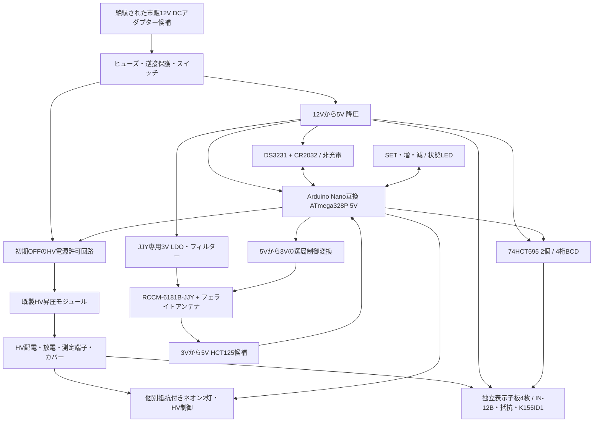

# 回路構成案 v0.2

状態：全体構成・仮計算の検討用。最新の制御板インターフェース/配線は [control-r1](control-board-r1.md)、全体の現在地は [HANDOFF.md](../HANDOFF.md) を参照。**以下は接続図、抵抗の確定値、製造指示ではない。** R01/R02/R04/R05/R06/R08が未解決。

更新：KiCadの接続検討図とケース並行設計は [Phase 2初版](phase2-review.md) を参照。機械寸法は [共通JSON](../enclosure/layout.json) が正本。以下の計算例はPhase 1時点の仮定で、図面の実装値ではない。子板の放電抵抗追加により電源負荷の再評価が必要。

## 基板分割

| 案 | 利点 | 課題 | 方針 |
| --- | --- | --- | --- |
| 全部を1枚に集約 | コネクターが少ない | 管間隔とケース寸法が固定、受信雑音の調整が難しい | 今回は優先しない |
| 制御＋固定4桁表示板 | 配線が単純、HVを表示板にまとめやすい | 管間隔の変更に再製造が必要 | ケース確定後の将来候補 |
| 制御＋独立した1桁表示子板×4＋コロン | 各管を位置調整でき、保守と検証がしやすい | 基板枚数・ハーネス・カバーが増える | 第一候補 |

各表示子板にIN-12Bソケット、電流制限抵抗、K155ID1を配置する案。これで10本のカソード線を基板間に引き回さず、HV/GND/+5V/BCD4bitを主な接続とする。論理側のJ50〜J53と表示板側J10〜J13の番号/ピンは回路図へ定義済み。HVコネクターの実部品は未選定。HVと低電圧ロジックは別コネクターを検討し、HVは接点定格・ピッチ・嵌合時の接触防止を満たす品にする。

管4本は仮治具上で等間隔から検討し、中央コロンの余白も変えられるようにする。基板外形、固定穴、表示面の高さは現物とケースモックまで凍結しない。端子の保護カバーは外装とは別に試験段階から必要。

## ブロック構成



図中の矢印は機能上の接続。JJYレベル変換は回路図と制御板へ反映済み。HV許可回路は回路図上の候補で、部品定格/故障時/出荷版の条件は未確定。全体は共通GNDの非絶縁二次側構成を想定しており、物理的なHV/LV分離がガルバニック絶縁を意味するわけではない。

## 電源と負荷の見積

| 電源 | 仮の負荷/選定条件 | 根拠と保留点 |
| --- | --- | --- |
| 12V入力 | 12V1Aを候補 | 後述の仮負荷なら余裕があるが、アダプターと全負荷を実測 |
| +5V | 連続0.15〜0.20Aを初期予算、降圧器は0.5A以上を候補 | K155ID1だけで最大約0.10A、MCU・ロジック・LED・RTCを加算。詳細は型番固定後 |
| JJY +3V | モジュール資料で最大75µA、電源は数mAの余裕 | 選局プルアップ、LDO待機電流、バッファ入力漏れを含める |
| HV | 4管最大14mA＋ネオン仮1mA＋放電約0.82〜0.91mA | クランプ等の追加負荷を除く。負荷保証20mA以上を下限検討、25mA級を候補 |

HV200V・20mAなら4W。仮にHV変換効率70%、5V負荷0.2A・降圧効率80%なら、12V入力電流は `(4/0.70 + 1/0.80)/12 ≈ 0.58A`。効率は測定値ではなく、待機電力や起動ピークを含めない概算。20mAに制限すれば十分という保証でもない。

## HV電圧と電流制限の論点

利用者の170〜180V案に対して、S01は電源200V以上を記載する。まず180Vで評価できる可能性と、200V付近に変更した場合の絶縁・ドライバー・抵抗への影響を比較する。**最終HV電圧を決定する前に抵抗を発注しない。**

各管に抵抗を1本ずつ設け、静的点灯する。電流式は次の通り。

```text
I_tube = (V_HV - V_discharge - V_driver) / R_anode
P_R = I_tube^2 × R_anode
```

以下は抵抗選定を説明するための仮定：維持電圧145V、ドライバー降下2.5V、目標3.0mA。145Vは実測値ではない。11kΩならHV180Vで約2.95mAだが、200Vでは約4.77mAとなり、原資料のDC上限3.5mAを超える。200Vで同じ仮定なら計算上17.5kΩが必要。これらをそのまま実装値とはしない。

電圧・抵抗許容差、各管の維持電圧とドライバー降下の最小/最大、暗所始動、温度、無負荷過電圧を含むコーナー計算が必要。S03の2.5Vは7mAでの上限であり、3mAでの一定値ではない。電流の上下限、抵抗の使用電圧、異常短絡時の損失を別々に評価する。

K155ID1の非選択端子を全動作状態で資料範囲内に保つ回路は未確定（R02）。クランプ等を追加する場合は、電源容量・漏れ・ゴースト点灯・起動順序を再計算する。

## コロンの条件付き計算

2灯はそれぞれ別の電流制限抵抗を持つ並列の枝とする。例えばHV180V、ネオン維持60V、0.5mAなら計算上240kΩ、抵抗損失0.06W。維持60V・電流0.5mAは採用品の保証値ではない。始動電圧と暗所始動時間を含め、採用資料・実測に基づいて再計算する（R07）。

ローサイドはMPSA42等300V級を候補とする。コロンは1Hzで同時制御できればよく、高速PWMは必須にしない。トランジスターの端子順、ベース抵抗、消灯時の漏れを確定する。

## 放電・耐圧・物理保護

放電抵抗の検討例を220kΩとすると、180Vで約0.82mA/0.147W、200Vで約0.91mA/0.182W、モジュール上限235Vでは約1.07mA/0.251W。110kΩを2本直列にする案なら、理想分担で各117.5V/0.126W。各0.5W級などを候補にできるが、使用電圧・許容差・1本故障時・温度を確認する。

```text
V(t) = V0 × exp(-t / (R_bleed × C_total))
t = R_bleed × C_total × ln(V0 / V_target)
E = 0.5 × C_total × V0^2
```

仮に総容量10µF、235V、220kΩなら、30Vまで約4.53秒、蓄積エネルギー約0.276J。モジュール内部容量と各基板の容量・分離時の経路が未確認なので、固定の待ち時間を安全保証にしない。30Vはここでの計算用判定点であり、触れてよいという意味ではない。交換時は入力とUSBを外し、各系統の電圧が0V近傍に低下したことを適切な計器で確認する手順へ落とす。

- 分離した子基板にも残留電荷がないよう、抵抗の位置と接続を設計する。単に電源板に1本置くだけでは全系統の放電を保証しない。
- 最終耐圧は公称180Vだけで決めない。出力235Vの可能性と起動・故障時を含めて評価する。HV追加コンデンサーは400V級等を候補とし、トランジスター300Vでも過渡余裕を別途評価する。
- HV対LV/取り付け金属に3mm以上の領域を初期配置で予約する案。これは認証規格から確定した安全距離ではない。材料CTI、汚損、標高、動作電圧、コネクター、ソケット近傍を確定して最終クリアランス/沿面距離を決める（R08）。
- 管/ソケットやK155ID1の隣接端子では3mmを取れない可能性がある。実パッケージの動作電圧と絶縁根拠を検討し、ルールを全面的に緩めてDRCだけ通さない。
- レジスト、木材、真鍮板を単独の感電防止バリアとみなさない。試作でも基板裏面、端子、コネクターを絶縁カバーで覆い、抜け止め・配線固定・金属との離隔を設ける。

## JJYの雑音対策

アンテナと受信モジュールは一体の受信ユニットとして、HV昇圧・降圧・MCU・USBから離して仮配置する。最初は10〜20cm等の可変距離で比較する案だが、これを保証された距離とは扱わない。アンテナの向き、真鍮板の近さ、アダプター自体の雑音も測定する。

受信用電源は専用LDO＋RC/フェライト等を比較。HVのスイッチング電流ループを小さくし、そのリターンを受信GNDへ流さない。MCU/ロジックは各IC直近にデカップリングを設け、表示のシリアル更新を必要時だけに抑える。

受信中のHV停止が有効かを、表示ON / 消灯のみ / 昇圧停止 / USB切断で比較する。HV停止だけで残留電圧が直ちに消えるわけではない。Nano互換機のUSBシリアル、電源LED、5V降圧器の雑音は残る。受信不能時はタイムアウトしてRTC時刻表示を続ける。

## 測定端子・起動順序

測定端子候補：12V、5V、3V、低電圧GND、JJY OUT（バッファ前後）、PDN1/2、DS3231 SQW、SER/SRCLK/RCLK、HV_ENABLE、カバー内のHV+/HV_RETURN。高電圧測定点を通常の操作部やUSB近傍に出さない。

起動順は「HVのハードウェア禁止 → 5V安定 → MCU/RTCの妥当性確認 → 595の出力確定 → HV許可」。リセット・ブラウンアウト・書込中・MCU停止時の許可回路も設計する。USBと外部5Vの同時接続による逆給電は互換機ごとに検証し、未検証の同時接続を前提にしない（R11）。
